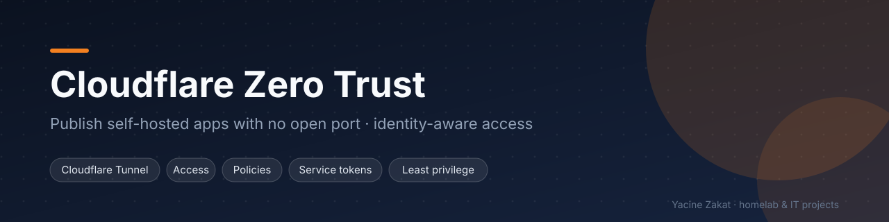
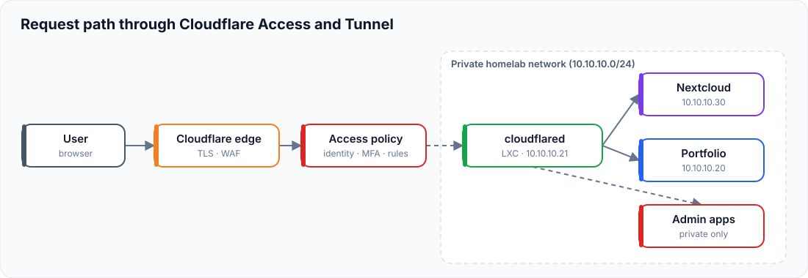

# Cloudflare Zero Trust & Secure Access

How I publish self-hosted applications from my Proxmox homelab **without opening a single inbound port**, and how I put identity checks in front of anything sensitive.

| | |
|---|---|
| **Status** | Tunnel in production in my homelab; access-policy models designed and tested |
| **Stack** | Cloudflare Tunnel (`cloudflared`), Cloudflare Access, Debian LXC on Proxmox VE |
| **Related** | [Proxmox homelab](https://github.com/bugHunte3R/Proxmox) · [Docker & Portainer](https://github.com/bugHunte3R/Docker-Portainer) · [Portfolio](https://github.com/bugHunte3R/React-Portfolio-V3) |

## Architecture

1. The browser reaches the Cloudflare edge over HTTPS (TLS terminates at Cloudflare, WAF applies).
2. For protected applications, a **Cloudflare Access** policy checks identity first.
3. The request travels through the tunnel that `cloudflared` opened **outbound** from my LAN.
4. The connector forwards it to the internal origin. Admin interfaces are never published.

## What I built

- A dedicated, minimal Debian LXC (1 vCPU / 512 MB) that only runs `cloudflared` as a systemd service
- Remotely managed tunnel, HTTP/2 transport (fixed an instability / error 1033 issue), auto-update disabled for controlled upgrades
- One public hostname per application, each pointing to a static internal address
- Reverse-proxy trust configured on the apps (e.g. Nextcloud `trusted_proxies`) so client IP and HTTPS are detected correctly
- Access policy models: allow-list by identity, one-time PIN or IdP login, short sessions for sensitive apps, service tokens for machine-to-machine calls

## Fictional addressing used in this repository

| Role | Address |
|---|---|
| Tunnel connector (LXC) | `10.10.10.21` |
| Docker host / portfolio | `10.10.10.20` |
| Nextcloud | `10.10.10.30` |
| Homelab network | `10.10.10.0/24` |

These are **examples**, not my real network.

## Documentation

| Topic | File |
|---|---|
| Architecture | [docs/architecture.md](docs/architecture.md) |
| Cloudflare Tunnel | [docs/cloudflare-tunnel.md](docs/cloudflare-tunnel.md) |
| Access control and policies | [docs/access-control.md](docs/access-control.md) · [docs/access-policies.md](docs/access-policies.md) |
| Identity verification | [docs/identity-verification.md](docs/identity-verification.md) |
| Location and IP signals | [docs/geo-ip-restrictions.md](docs/geo-ip-restrictions.md) |
| Service tokens | [docs/service-tokens.md](docs/service-tokens.md) |
| Applications | [docs/applications.md](docs/applications.md) |
| Monitoring and audit | [docs/monitoring-audit.md](docs/monitoring-audit.md) |
| Troubleshooting | [docs/troubleshooting.md](docs/troubleshooting.md) |
| Roadmap | [docs/future-improvements.md](docs/future-improvements.md) |

## Skills demonstrated

Zero Trust architecture · reverse tunnels · identity-aware access · least privilege · DNS · TLS · systemd · Linux troubleshooting · secure documentation

## Security

No tokens, tunnel credentials, domains, real addresses or account names are stored here. See [SECURITY.md](SECURITY.md).

---
**Yacine Zakat** — IT Support & Application Support Technician
