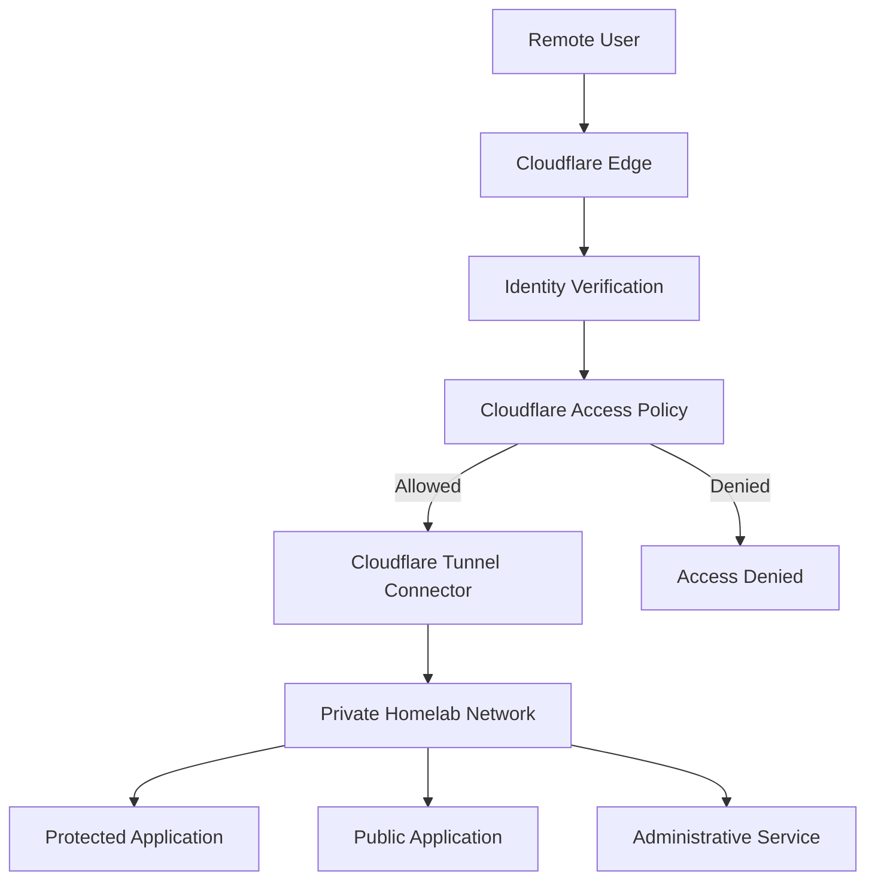
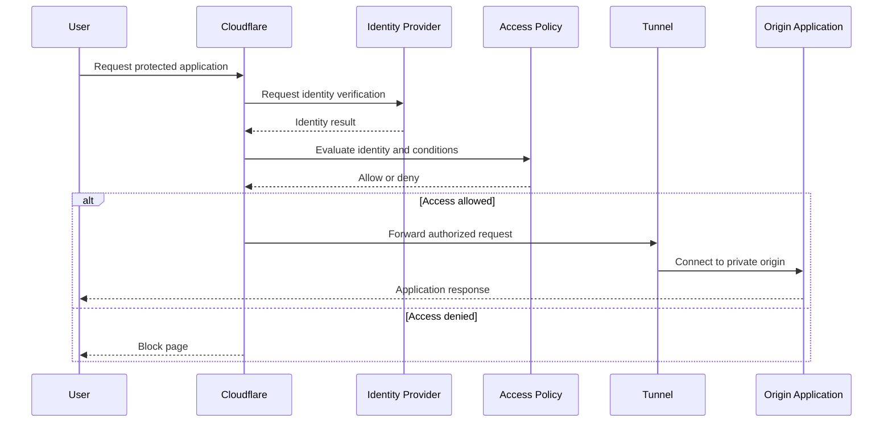

# Cloudflare Zero Trust & Secure Access


## Overview

This repository presents the Cloudflare Zero Trust architecture used to securely publish and protect selected services hosted in my personal homelab.

The environment uses Cloudflare Tunnel to connect internal applications to Cloudflare without directly exposing their local web ports through the router. Cloudflare Access policies are used to verify user identity and evaluate additional conditions before granting access to protected applications.

The implementation demonstrates practical experience with:

- Cloudflare Zero Trust
- Cloudflare Tunnel
- Cloudflare Access
- Identity-aware access control
- One-time PIN authentication
- Identity providers
- Include, Require and Exclude policy logic
- Country-based access restrictions
- IP and network restrictions
- Application-level access policies
- Service tokens
- Secure publication of private applications
- Least-privilege access
- Policy testing and troubleshooting
- Security documentation

> **Privacy notice:** this repository contains only sanitized architecture documentation and examples. Real domains, public IP addresses, internal IP addresses, tunnel identifiers, credentials, account identifiers, email addresses, tokens and production policies are excluded or replaced with placeholders.

---

## Architecture



Detailed documentation:

- [Architecture](docs/architecture.md)
- [Cloudflare Tunnel](docs/cloudflare-tunnel.md)
- [Zero Trust Access](docs/access-control.md)
- [Identity verification](docs/identity-verification.md)
- [Access policies](docs/access-policies.md)
- [Country and IP restrictions](docs/geo-ip-restrictions.md)
- [Service tokens](docs/service-tokens.md)
- [Application inventory](docs/applications.md)
- [Security model](docs/security.md)
- [Monitoring and audit](docs/monitoring-audit.md)
- [Troubleshooting](docs/troubleshooting.md)
- [Future improvements](docs/future-improvements.md)

---

## Security Objectives

The design follows these goals:

- Do not expose internal application ports directly
- Verify user identity before granting access
- Restrict administrative applications to approved users
- Restrict access by country when appropriate
- Block known unwanted IP addresses or networks
- Use short application sessions for sensitive services
- Use service tokens for machine-to-machine access
- Keep management applications private
- Apply least-privilege access
- Maintain audit visibility
- Avoid storing production secrets in Git

---

## Cloudflare Tunnel

Cloudflare Tunnel creates outbound connections from the homelab to Cloudflare.

```text
Internal application
        |
        v
cloudflared connector
        |
        v
Outbound encrypted connection
        |
        v
Cloudflare edge
        |
        v
Authorized user
```

Benefits of this design:

- No direct inbound web-port forwarding for protected applications
- Internal origin addresses remain private
- Public hostnames can map to internal services
- Access policies can be applied before traffic reaches the origin
- The tunnel connector can run in an isolated Linux container
- Multiple applications can be routed through one managed tunnel

The real tunnel ID and credential file are not included.

---

## Zero Trust Access Flow



---

## Access Policy Logic

Cloudflare Access policies use three main rule types:

| Rule type | Purpose | Logical behavior |
|---|---|---|
| Include | Defines who is eligible | OR between Include conditions |
| Require | Adds mandatory conditions | AND with the eligible identity |
| Exclude | Removes users or conditions | Denies matching users |

Example policy concept:

```text
ALLOW access when:

INCLUDE
- Approved email address
- Approved identity group

REQUIRE
- User is located in an approved country
- User completed identity verification

EXCLUDE
- Blocked email addresses
- Blocked IP addresses
- High-risk identities
```

A broad `Include Everyone` condition should not be used for sensitive administrative applications unless it is combined with carefully reviewed mandatory conditions.

---

## Identity Verification

Protected applications can require identity verification before access.

Possible identity methods include:

- One-time PIN sent to an approved email address
- Google Workspace
- Microsoft Entra ID
- GitHub
- Okta
- Cloudflare account membership
- Other supported identity providers

For a personal homelab, one-time PIN or a trusted identity provider can protect selected applications without exposing the application's own login page directly to unauthorized users.

Example:

```text
User opens protected hostname
        |
        v
Cloudflare requests authentication
        |
        v
User proves ownership of approved identity
        |
        v
Access policy checks all conditions
        |
        v
Application is displayed only if allowed
```

---

## Application Access Levels

| Application category | Recommended access |
|---|---|
| Public portfolio | Public or limited application protection |
| Private dashboard | Identity verification required |
| Portainer | Private network or strict Access policy |
| Proxmox administration | VPN preferred; not public |
| UniFi administration | VPN or strict Access policy |
| Nextcloud | Application login plus optional Access layer |
| Internal tools | Approved identities only |
| Automated webhook/API | Service token or application-specific authentication |

Cloudflare Access adds an identity-aware security layer but should not replace the application's own authentication for sensitive systems.

---

## Country Restrictions

Access policies can require or exclude countries.

Example concept:

```text
Allow:
- Approved identity

Require:
- Country is Canada
- Country is Morocco

Exclude:
- Selected blocked countries
```

Country-based filtering is an additional signal, not a complete identity-verification mechanism. VPNs, proxies and mobile networks can affect geolocation.

For public websites, Cloudflare WAF custom rules or IP Access rules can also be used to block or challenge traffic based on IP, ASN or country.

---

## IP Restrictions

IP-based controls can be used to:

- Allow trusted administrative source networks
- Block known unwanted IP addresses
- Block abusive networks
- Restrict applications to expected networks
- Challenge suspicious traffic

Examples in this repository use reserved documentation addresses:

```text
Trusted network: 192.0.2.0/24
Blocked address: 203.0.113.50
Example IPv6:    2001:db8::/32
```

These addresses do not represent the production environment.

---

## Access Policy Examples

### Approved Email and Country

```text
Action: Allow

Include:
- Email equals administrator@example.com

Require:
- Country is CA

Exclude:
- Blocked IP list
```

### Approved Identity Group

```text
Action: Allow

Include:
- Identity group: Homelab Administrators

Require:
- Authentication method is approved
- Session duration is limited
```

### Machine-to-Machine Service

```text
Action: Service Auth

Include:
- Valid service token
```

### Explicit Deny Policy

```text
Action: Block

Include:
- Known unwanted IP address
```

Policy ordering and scope should be reviewed carefully before deployment.

---

## Hosted Applications

The Cloudflare environment protects or publishes selected homelab services.

| Service category | Publication model |
|---|---|
| Portfolio | Public hostname through tunnel |
| Nextcloud | Tunnel with application authentication |
| Internal dashboard | Tunnel with Access authentication |
| Administrative application | Strict Access policy or VPN-only |
| API or automated integration | Service token |
| Test application | Temporary protected hostname |

Exact application names, hostnames and internal addresses are intentionally excluded.

---

## Security Layers

```text
Layer 1: DNS and Cloudflare edge
Layer 2: WAF and traffic filtering
Layer 3: Cloudflare Access identity verification
Layer 4: Access policy conditions
Layer 5: Cloudflare Tunnel
Layer 6: Internal firewall and network controls
Layer 7: Application authentication and authorization
```

No single layer is treated as sufficient on its own.

---

## Repository Structure

```text
.
├── README.md
├── SECURITY.md
├── LICENSE
├── .gitignore
├── docs/
│   ├── architecture.md
│   ├── cloudflare-tunnel.md
│   ├── access-control.md
│   ├── identity-verification.md
│   ├── access-policies.md
│   ├── geo-ip-restrictions.md
│   ├── service-tokens.md
│   ├── applications.md
│   ├── security.md
│   ├── monitoring-audit.md
│   ├── troubleshooting.md
│   └── future-improvements.md
├── diagrams/
│   ├── architecture-diagram.md
│   ├── authentication-flow.md
│   └── policy-evaluation.md
├── examples/
│   ├── cloudflared-config.example.yml
│   ├── access-policy.example.json
│   ├── geo-restriction.example.txt
│   ├── service-token-request.example.sh
│   └── environment.example
├── scripts/
│   ├── cloudflared-health-check.example.sh
│   ├── origin-connectivity-check.example.sh
│   └── secret-scan.example.sh
└── screenshots/
    └── README.md
```

---

## Skills Demonstrated

### Cloudflare

- Zero Trust dashboard administration
- Cloudflare Tunnel
- Cloudflare Access
- Access applications
- Identity providers
- Email one-time PIN
- Access policies
- Country and IP rules
- Service authentication
- Traffic filtering

### Security

- Identity-aware access
- Least privilege
- Explicit allow and deny conditions
- Session restriction
- Defense in depth
- Secret management
- Audit awareness
- Sanitized public documentation

### Linux and Networking

- Linux service management
- `cloudflared`
- Internal routing
- DNS
- HTTP and HTTPS troubleshooting
- Origin connectivity testing
- Reverse-tunnel architecture
- systemd restart policies

---

## Information Intentionally Excluded

- Cloudflare account ID
- Cloudflare zone ID
- Tunnel UUID
- Tunnel token
- Tunnel credential JSON
- API tokens
- Service-token client ID and secret
- Real domains
- Real subdomains
- Real public IP address
- Real internal IP addresses
- Approved email addresses
- Identity-provider tenant details
- Access application IDs
- Policy IDs
- Blocked IP lists
- Country-blocking strategy
- Audit logs
- Personal application data

---

## Author

**Yacine Zakat**

IT Support and Application Support Technician with practical experience in Linux, virtualization, Docker, networking, Cloudflare Zero Trust, secure remote access and self-hosted services.

This project is used for continuous learning and hands-on infrastructure security administration.

---

## Disclaimer

This repository is provided for demonstration and educational purposes.

All policy examples are sanitized and must be reviewed before use. Security policies should be tested carefully to avoid accidental lockout or unintended access.
